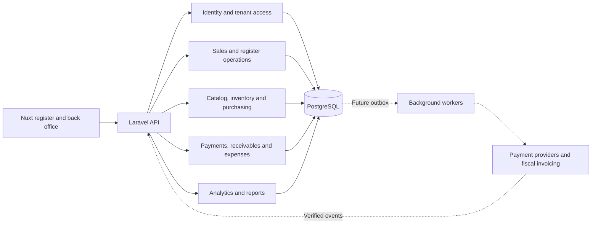

# Northstar POS architecture

Northstar is an online-first, multi-shop retail system. Nuxt provides the register and back-office interfaces. Laravel exposes versioned commands and queries, with PostgreSQL as the source of truth. Start with one deployable Laravel application and keep domain boundaries in code so sales, inventory, and credit can commit together. Introduce durable background processing for operations that depend on external systems.

## Domain boundaries

| Domain | Implemented | Target architecture |
| --- | --- | --- |
| Identity and tenancy | Platform onboarding, shop and branch roles, Sanctum, staff setup and resets, append-only business audit trail | User lifecycle, explicit branch membership if users cover multiple sites, revocable register devices, separate platform and shop privileges. |
| Catalog and pricing | SKU, barcode, categories, variants, unit prices and costs, shop tax setting | Product families and variants, units and packaging, per-branch price lists, effective-dated tax rules, promotion eligibility and stacking, price override approval. Snapshot prices, tax, and discounts at checkout. |
| Register and sales | Transactional single-tender checkout, receipt snapshots, idempotent retry | Register and shift, suspended carts, split tenders, discounts, receipt sequences, return and void workflows. Reference original sale lines for returns and cap cumulative returned units. |
| Inventory and purchasing | Branch stock balance, append-only movements, transfers, full PO receiving | Stock counts and variance approval, partial receiving and supplier returns, in-transit and received transfer states, reservations for asynchronous payment, inventory costing and optional lot tracking. |
| Payments and finance | Recorded tenders, expenses, payment ledger, customer credit limits and repayments | Provider attempts and signed webhook inbox, matching to settlement batches, reversal and refund records, till reconciliation and accounting exports. Track credit by receivable and allocate repayments to invoices if aging is required. |
| Customers and suppliers | Shop-wide directories, sale customer snapshots | Customer consent and retention controls, supplier terms, receivable and payable statements when invoice and allocation data exist. |
| Receipts and fiscal invoicing | Receipt branding and browser printing | Fiscal invoice and credit note workflow, submission status, provider document IDs, error review and retry. Verify the applicable KRA eTIMS integration and registration requirements before deployment. [KRA eTIMS](https://www.kra.go.ke/online-services/etims) |
| Reporting | Branch/day sales, tender mix, cashier totals, product ranking, recorded expenses, credit flows, low-stock and category stock | Comparison periods, product/category and returns analysis, register cash variance, settlement reconciliation, aged credit, inventory value, scheduled exports. |
| Device and offline | Browser scans, browser printing, online writes | Register pairing and optional printer bridge. If offline sales become a product requirement, define device identity, queued operation IDs, offline stock/payment rules, conflict resolution and reconciliation before enabling writes. |

Retail order APIs commonly represent line items, modifiers, taxes and adjustments separately. Northstar currently stores receipt lines as immutable JSON snapshots. Add relational sale lines alongside the snapshot when line-level returns, cost allocations or sustained analytics volume justify the migration. Preserve historical amounts when backfilling. [Square Orders API](https://developer.squareup.com/docs/orders-api/what-it-does)

## Transaction and integration design

- Derive tenant and branch access from the authenticated principal. Scope lookups, writes, exports and provider events by shop. Enforce applicable tenant relationships with composite foreign keys. Restrict financial reports and PII to authorized roles.
- Keep integer minor units for money and store currency on financial facts. Store timestamps in UTC and use a persisted branch business timezone and explicit day boundaries for closeout. Until branch timezones are introduced, reports use a request timezone with an Africa/Nairobi default.
- Settle recorded sales atomically with inventory movements and receivables. Keep posted records immutable. Implement voids, returns and corrections with compensating rows and an original-record reference. Record the actor, reason and timestamps. Lock affected records in a consistent order and apply bounded retries to database concurrency failures.
- Add registers and shifts before till reconciliation. At close, compare opening float plus cash inflows minus cash refunds, payouts and drops with the counted cash. Persist the count, variance, operator and approval.
- For live tenders, store a payment attempt before calling a provider. Keep provider references and idempotency keys per attempt, authenticate inbound callbacks, deduplicate events and reconcile ambiguous results. Complete the sale against a confirmed tender and a valid reservation. Handle expiration, cancellation and refund as explicit transitions. [Stripe Payment Intents](https://docs.stripe.com/payments/payment-intents)
- Store a durable outbox row in the same transaction as each event that must reach an external system. Workers claim committed rows and retry with backoff. Deduplicate consumers using stable event IDs, and retain failed work for operational review. Laravel after-commit dispatch is appropriate when the task must wait for a successful database commit. [Laravel queues and database transactions](https://laravel.com/docs/13.x/queues#jobs-and-database-transactions)

## Audit trail

Laravel records successful business operations and selected account events in PostgreSQL. Each business write and its audit event share a transaction. The audit read API authorizes platform and shop administrator scopes independently. Audit metadata uses explicit fields, including actor role, subject IDs, and operation references. Uploaded contents, secrets, and full before/after snapshots stay outside the audit trail. PostgreSQL rejects ordinary updates, deletes, and truncation. Use a non-owner application role and separate schema administration privileges to preserve that boundary. Failed authentication and security monitoring belong in a separate operational stream.

## Analytics contract

`GET /api/v1/analytics`, `GET /api/v1/reports`, and `GET /api/v1/dashboard` expose the same finance-authorized dataset. Filter by inclusive local dates or an exact half-open timestamp range, reporting timezone, and authorized branch. Sales and their tenders can also be filtered by salesperson, customer, product, and payment method. Product filters select whole receipts. Customer filters also scope repayments. Sales and payments use UTC instants mapped to local day boundaries. Expenses use their recorded business date. Inventory metrics describe current stock, independent of the date range.

| Metric | Definition |
| --- | --- |
| Sales and average receipt | Sum and rounded average of completed receipt totals including tax. |
| Sales excluding tax and tax | Sum of the receipt subtotals and recorded tax respectively. |
| Estimated cost and gross profit | Sale-time unit cost multiplied by quantity. Gross profit is pre-tax sales minus estimated cost. |
| Credit sales and repayments | Separate sums of credit sale tenders and posted repayments. Credit tender is included in the sales payment mix. |
| Purchases | Orders placed by creation date, orders received by receipt date, and received quantities multiplied by the purchase order unit costs. |
| Recorded expenses | Expense amounts with an incurred date in the requested period. |
| Top products | Top 20 products by pre-tax line revenue with units sold. Historical sale lines provide the quantities and amounts. |
| Cashier and daily sales | Completed receipts grouped by operator or by reporting day and branch. |
| Current inventory | Quantity by product category and count of configured branch/product balances at or below their reorder threshold. The low-stock list includes up to 50 balances. |

The report runs in one PostgreSQL repeatable-read transaction so its sections see a consistent snapshot. Benchmark representative shop-wide and branch queries before introducing projections. If the reporting workload warrants it, add indexed daily facts by shop, branch, currency, date and product or tender. Refresh them from committed events, publish a freshness watermark, and reconcile projections against source totals. Add explicit refund, discount and net-sales metrics when their underlying ledgers exist. [PostgreSQL transaction isolation](https://www.postgresql.org/docs/current/transaction-iso.html#XACT-REPEATABLE-READ)

## Delivery order and operational checks

1. Wire Nuxt to the existing API, keep a stable checkout UUID across retries, load initial branch and catalog data, and verify receipt printing.
2. Add register shifts, returns and tender splits. Test simultaneous checkouts competing for the same stock, retry behavior, cross-shop and cross-branch denial, and ledger reconciliation.
3. Add asynchronous provider and fiscal workflows. Verify duplicate and out-of-order callbacks, interrupted payments, timeout reconciliation, refunds and fiscal credit notes in provider sandboxes.
4. Extend purchasing, inventory costing, receivable allocations and analytics as operational requirements are confirmed. Reconcile reports to posted business records and test local midnight and empty periods.
5. Deploy over HTTPS with protected application and provider secrets, shared rate-limit storage, scheduled PostgreSQL backups and restore rehearsals. Alert on checkout errors, failed jobs, stale fiscal submissions and reconciliation exceptions. Track query latency and database lock waits as transaction volume grows.
